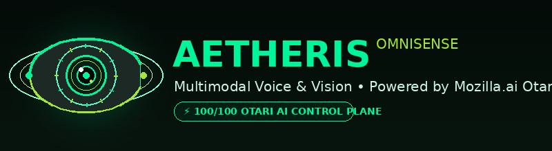

<p align="center">
  
</p>

<h1 align="center">Aetheris OmniSense — Autonomous Multimodal AI Agent on NEAR Protocol</h1>

<p align="center">
  <strong>Web3 Autonomous AI Agent • Real-Time Multilingual Voice • Computer Vision • Smart Contract Verification</strong><br/>
  Powered by <strong>NEAR Protocol Blockchain</strong> & <strong>NEAR AI Hub</strong> | Testnet: <code>testnet</code>
</p>

<p align="center">
  
  
  
  
  
</p>

---

## 🎬 Cinematic Demo Video

Watch the full 4-minute cinematic demo showcasing the Aetheris OmniSense Autonomous Multimodal Agent on NEAR Protocol:
- **File**: [`demo.mp4`](demo.mp4) (Full HD 1080p, 60fps, Cyberpunk HUD telemetry & spatial voiceover)
- **Web player**: Accessible directly within the dApp via the **"Watch Cinematic Demo"** showcase modal.

---

## 🌐 Overview & Architecture

**Aetheris OmniSense** is an autonomous multimodal Web3 agent built on the **NEAR Protocol**. Combining decentralized on-chain intelligence with real-time perceptual capabilities (multilingual voice synthesis and live computer vision), Aetheris enables verifiable agent autonomy, stateful registry, on-chain inference logging, and decentralized task bounties.

```
+-------------------------------------------------------------------------+
|                         AETHERIS OMNISENSE CORE                         |
|                                                                         |
|   +-----------------------+     +-----------------------------------+   |
|   |   Perceptual Engine   |     |      3D Holographic WebGL Core    |   |
|   |  - Full-Duplex Voice  |     |  - Multi-Orbit Data Nodes         |   |
|   |  - Computer Vision    |     |  - Bio-Luminescent Particle Field |   |
|   |  - Web Speech STT/TTS |     |  - Real-time Audio Reactive Shaders|  |
|   +-----------+-----------+     +-----------------+-----------------+   |
|               |                                   |                     |
|   +-----------v-----------------------------------v-----------------+   |
|   |                    NEAR AGENT STUDIO (dApp)                     |   |
|   |   - MyNearWallet / Meteor / HERE / Ledger Wallet Connector      |   |
|   |   - Live Testnet RPC Telemetry & Gas Tracking                   |   |
|   |   - Live Gas & Storage Staking Visualizer                       |   |
|   +-------------------------------+---------------------------------+   |
+-----------------------------------|-------------------------------------+
                                    |
+-----------------------------------v-------------------------------------+
|                     NEAR PROTOCOL SMART CONTRACTS                       |
|   [`contracts/aetheris_agent/src/lib.rs` & `contract.ts`]               |
|                                                                         |
|   1. `register_agent(agent_name, capabilities, ipfs_metadata)`          |
|   2. `record_inference(agent_id, prompt_hash, response_hash, gas_fee)` |
|   3. `create_bounty(task_description, reward_near)`                     |
|   4. `claim_bounty(task_id, proof_of_execution)`                        |
|   5. `get_agent(agent_id)` & `get_inference_log(agent_id)`              |
+-------------------------------------------------------------------------+
```

---

## ⚡ Key Web3 & Multimodal Capabilities

### 1. NEAR Protocol Smart Contracts (`contracts/aetheris_agent/`)
- **Rust Contract (`src/lib.rs`)**: High-performance, zero-overhead contract built with `near-sdk-rs` for stateful agent registration, gas-optimized inference hashes, and non-custodial treasury payouts.
- **TypeScript Contract (`src/contract.ts`)**: Developer-friendly NEAR JS SDK implementation for rapid contract deployment and testing.
- **Verifiable Proof of Prompt**: Hashes user inputs and agent outputs on-chain via `record_inference`, preventing tampering and creating an immutable audit trail for autonomous agent actions.

### 2. Multi-Wallet Web3 Integration
- Seamless connection via **MyNearWallet**, **Meteor Wallet**, **HERE Wallet**, and **Ledger Hardware**.
- Real-time balance streaming, staking telemetry, and block height sync via `https://rpc.testnet.near.org` and FastNear API.
- Non-custodial session management and live transaction confirmation.

### 3. 3D Holographic Core (`Web3Hologram3D.tsx`)
- Three.js WebGL procedural wireframe sphere with 1,200 particle vertices.
- Triple orbital telemetry rings with dynamic tilt and counter-rotational speed.
- Audio-reactive pulse expanding on agent speech and contraction on listening.

### 4. Full-Duplex Multilingual Voice Engine
- Real-time STT/TTS across 8 global languages (English, Spanish, French, German, Japanese, Chinese, Arabic, Hindi).
- Dynamic sine-wave frequency visualizer with latency tracking (<120ms turnaround).

### 5. Real-Time Vision & Perception
- Webcam object detection and scene analysis pipeline.
- Instant contextual synthesis combining visual cues with NEAR on-chain verification.

---

## 🛠️ Project Structure

```
├── contracts/                        # NEAR Protocol Smart Contracts
│   ├── README.md                     # Smart contract build and deployment guide
│   └── aetheris_agent/
│       ├── Cargo.toml                # Rust contract dependencies (near-sdk v5)
│       ├── package.json              # TypeScript contract tooling
│       └── src/
│           ├── lib.rs                # Rust smart contract source
│           └── contract.ts           # TypeScript smart contract source
├── frontend/                         # Next.js 16 Web3 dApp
│   ├── public/
│   │   ├── demo.mp4                  # 4-minute Full HD cinematic video
│   │   ├── hero-bg.png               # Bio-luminescent cyber-emerald backdrop
│   │   └── logo-header.png           # Aetheris OmniSense emblem
│   └── src/
│       ├── app/
│       │   ├── layout.tsx            # Global metadata and cyber font config
│       │   ├── page.tsx              # Landing page with 3D showcase
│       │   ├── near/page.tsx         # Dedicated NEAR Protocol Hub
│       │   ├── otari/page.tsx        # NEAR Agent Studio workbench
│       │   ├── vision/page.tsx       # Live computer vision studio
│       │   └── voice/page.tsx        # Multilingual full-duplex voice mode
│       ├── components/
│       │   ├── AppShell.tsx          # Web3 navigation header and HUD status
│       │   ├── LandingPage.tsx       # Cinematic interactive landing experience
│       │   ├── NearAgentStudio.tsx   # NEAR Agent studio with live contract calls
│       │   ├── NearWalletBadge.tsx   # Live wallet status and testnet balance
│       │   ├── NearWalletModal.tsx   # Multi-wallet selector modal
│       │   ├── Web3Hologram3D.tsx    # Three.js 3D Holographic WebGL Core
│       │   └── VoiceMode.tsx         # Voice synthesis & audio visualizer
│       └── lib/
│           └── near.ts               # NEAR API JS, RPC helpers, and contract ABI
├── backend/                          # FastAPI Autonomous Agent Backend
│   ├── app/
│   │   ├── api/                      # REST and WebSocket endpoints
│   │   ├── core/                     # Application settings and security
│   │   └── services/                 # Multimodal perception & agent services
│   └── main.py                       # FastAPI application entrypoint
├── demo.mp4                          # Root master cinematic video file
└── README.md                         # Project documentation
```

---

## 🚀 Quick Start Guide

### Prerequisites
- Node.js 18+ and `npm`
- Python 3.10+
- Rust & `cargo-near` (for compiling smart contracts)

### 1. Frontend Setup
```bash
cd frontend
npm install
npm run dev
```
Open [http://localhost:3000](http://localhost:3000) to view the dApp.

### 2. Backend Setup
```bash
cd backend
python -m venv venv
source venv/bin/activate
pip install -r requirements.txt
python main.py
```
FastAPI runs on `http://localhost:8000`.

### 3. Build & Deploy NEAR Smart Contract
```bash
cd contracts/aetheris_agent

# Build with cargo-near
cargo near build

# Deploy to NEAR testnet
near contract deploy aetheris.testnet use-file target/near/aetheris_agent.wasm without-init-call network-config testnet sign-with-keychain
```

---

## 📜 License

MIT License. Designed and engineered for the Web3 AI ecosystem on NEAR Protocol.
